<p align="center">
  
</p>

<h1 align="center">bspx</h1>

<p align="center">
  An animated BSP tiling window manager for macOS, written in Rust.
</p>

## Features

- BSP tiling with smooth animations
- A separate layout for every Space
- Zoom a window to full screen or its split's area, and back
- Keeps clear of the Dock, uses the full screen when it hides
- Swap a window with its neighbour, or warp it into its neighbour's place
- New windows never squeeze windows of their own size: with no room left, they open floating in the middle. A bigger one, like WhatsApp next to Terminals, gets room from the others, never below their minimum size
- Drag a window onto another to swap them, resize with the mouse
- Hold `alt` to move or resize a window from anywhere on it
- Hold a second key while dropping to split the window under it instead of swapping
- Optional focus follows mouse and mouse follows focus
- Built-in keyboard shortcuts
- Named Spaces, switching Spaces, rules that send apps to them, and floating Spaces
- Rules that open an app's windows floating at a place and size of your choosing, on a grid
- Shell-script config
- No need to disable SIP

<details>
<summary><b>Demo</b></summary>
<br>

<details><summary>Focus — <code>bspx focus</code></summary><br>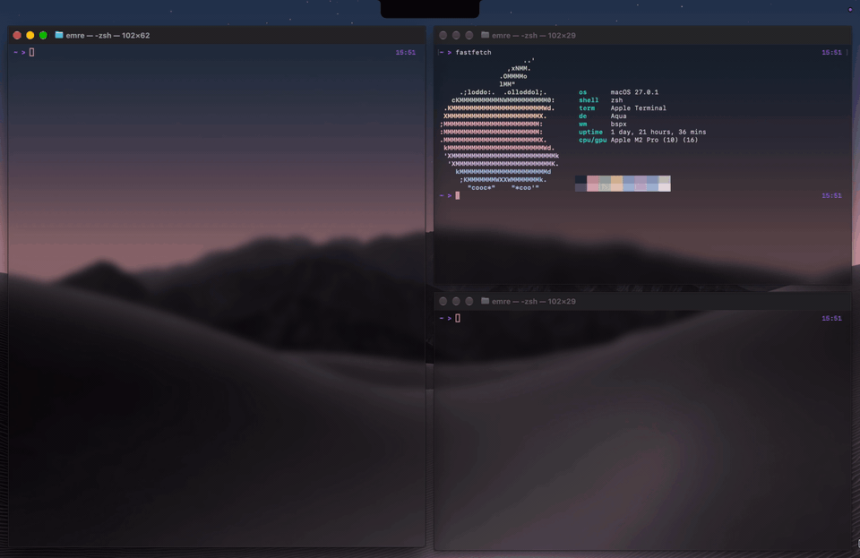</details>
<details><summary>Swap — <code>bspx swap</code></summary><br>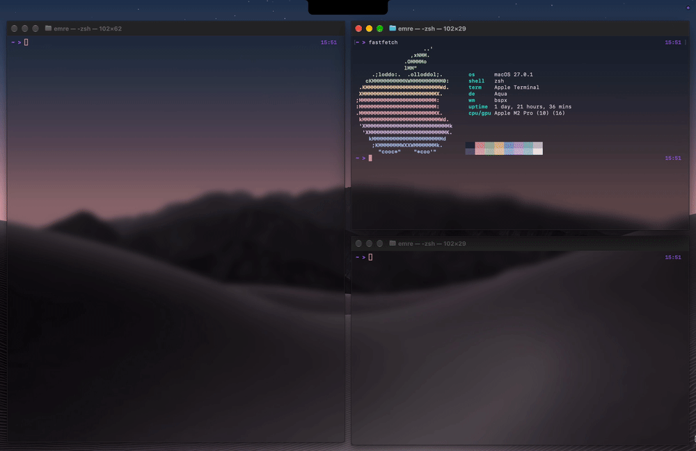</details>
<details><summary>Warp — <code>bspx warp</code></summary><br>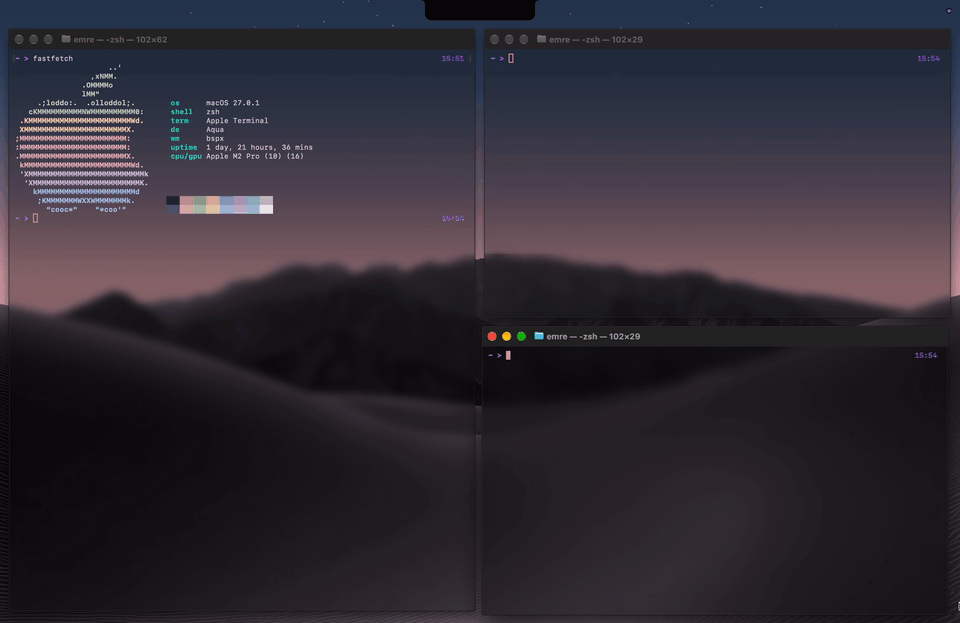</details>
<details><summary>Resize — <code>bspx resize</code></summary><br>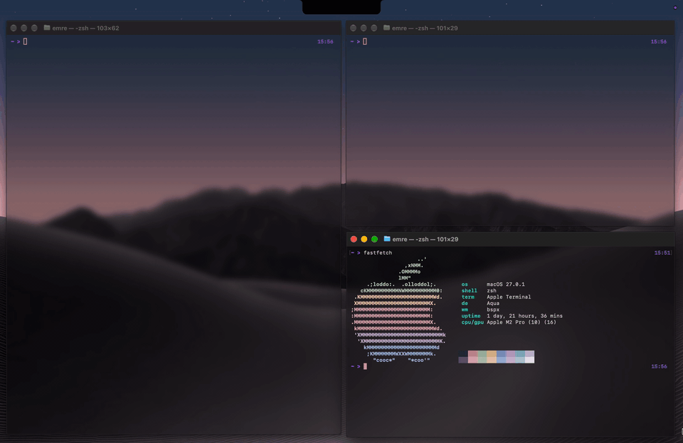</details>
<details><summary>Rotate — <code>bspx rotate</code></summary><br>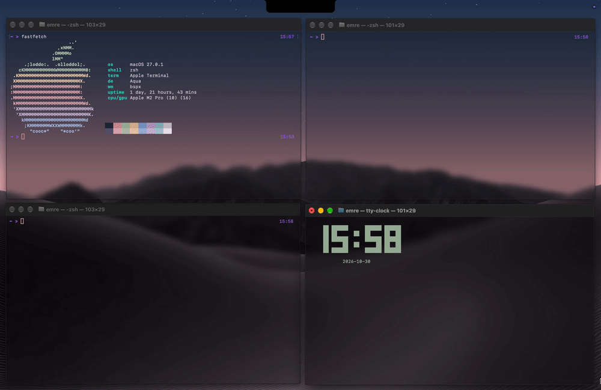</details>
<details><summary>Toggle split — <code>bspx toggle-split</code></summary><br>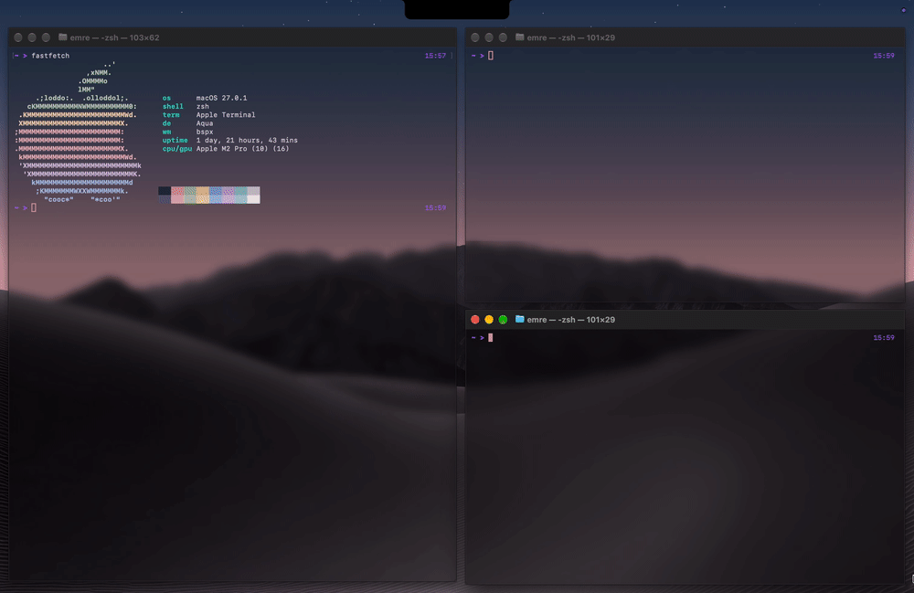</details>
<details><summary>Balance — <code>bspx balance</code></summary><br>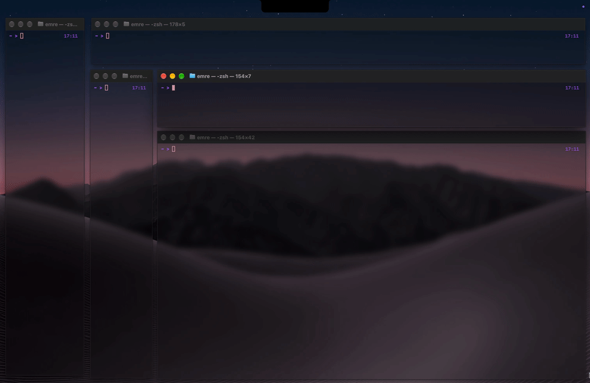</details>
<details><summary>Zoom — <code>bspx zoom</code></summary><br>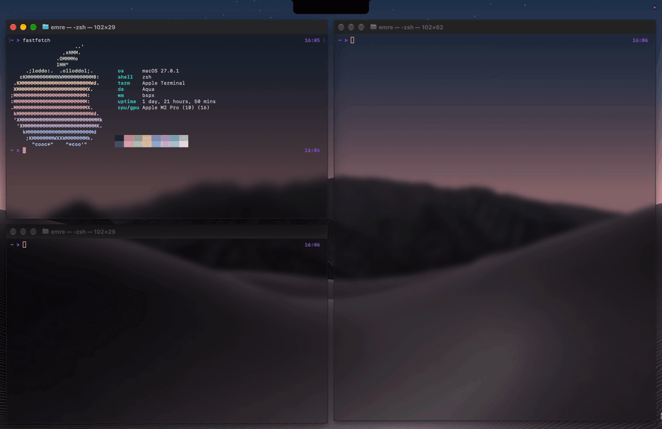</details>
<details><summary>Zoom parent — <code>bspx zoom parent</code></summary><br>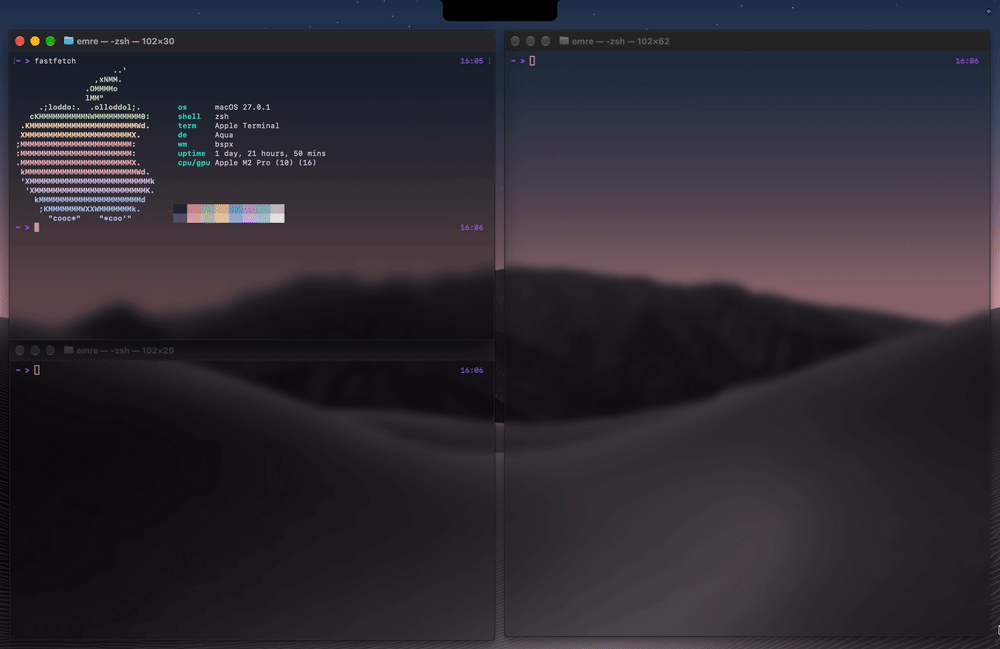</details>
<details><summary>Float — <code>bspx float</code></summary><br>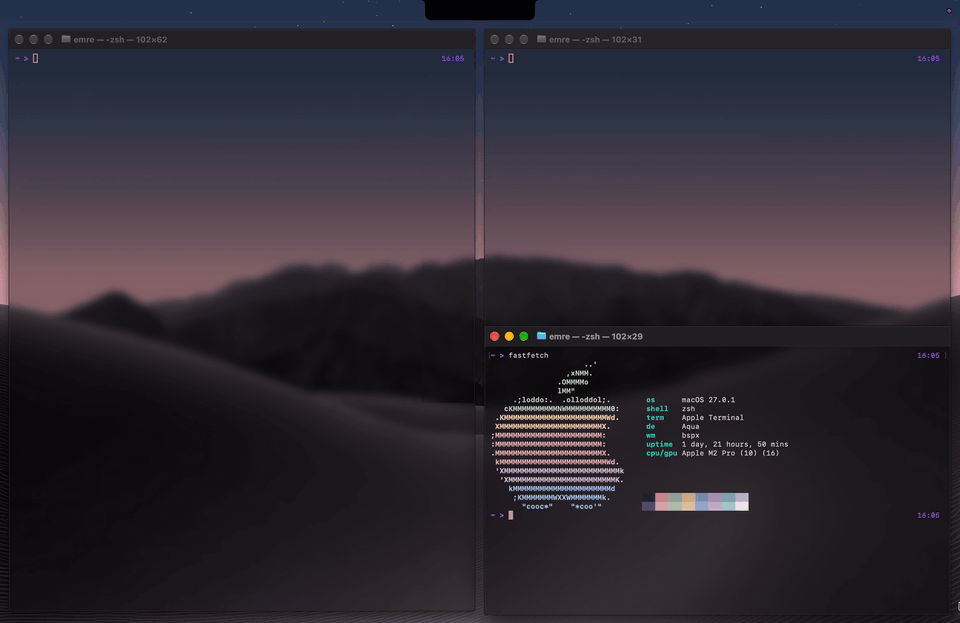</details>
<details><summary>Swap with the mouse</summary><br>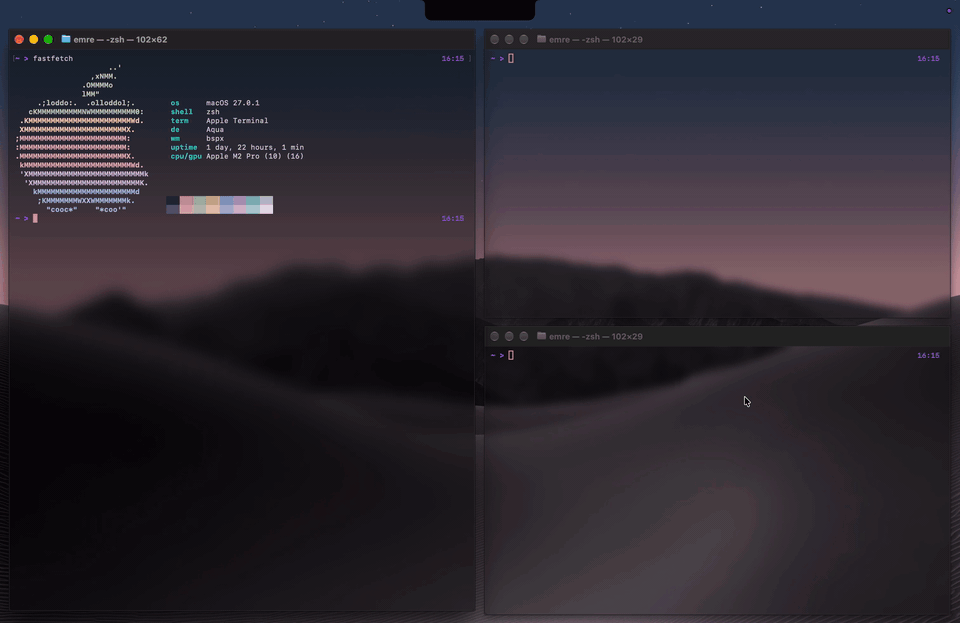</details>
<details><summary>Split by dropping</summary><br>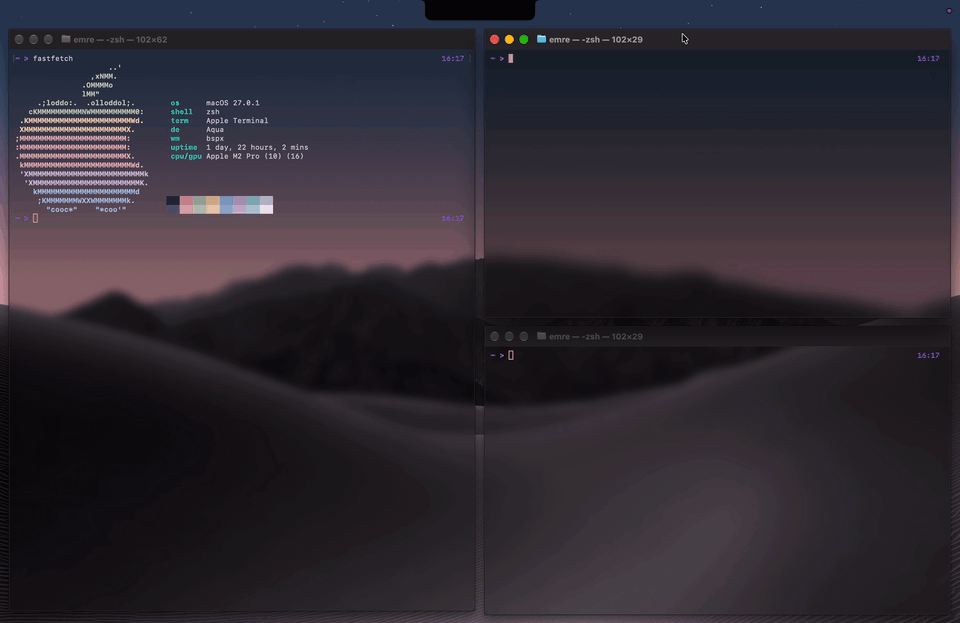</details>
<details><summary>Move with <code>alt</code>-drag</summary><br>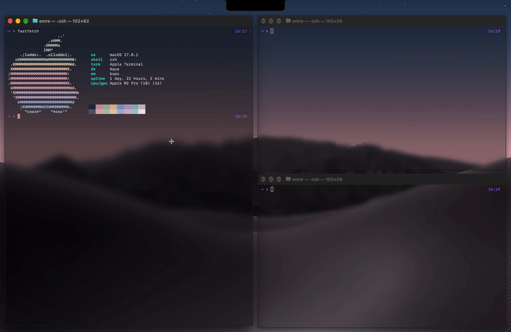alt</code>-drag"></details>
<details><summary>Resize with <code>alt</code>-right-drag</summary><br>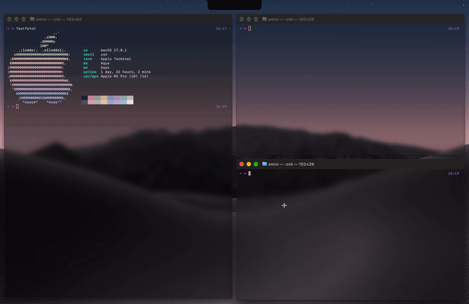alt</code>-right-drag"></details>
<details><summary>Switch Spaces — <code>bspx space</code></summary><br>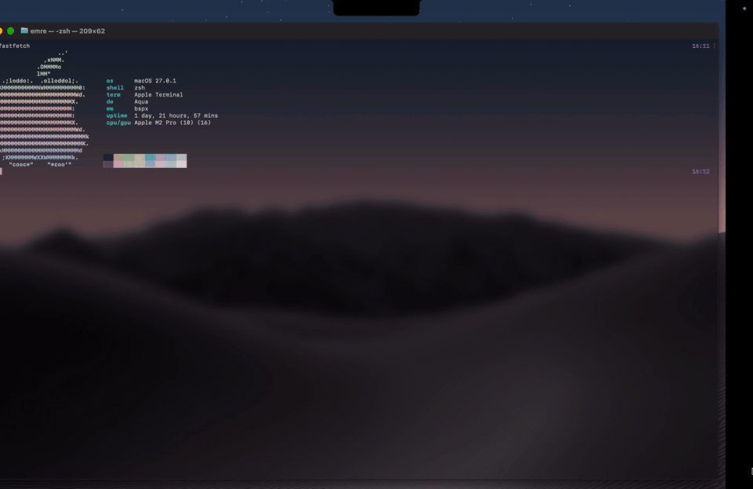</details>
<details><summary>Take a window to a Space — <code>bspx send</code></summary><br>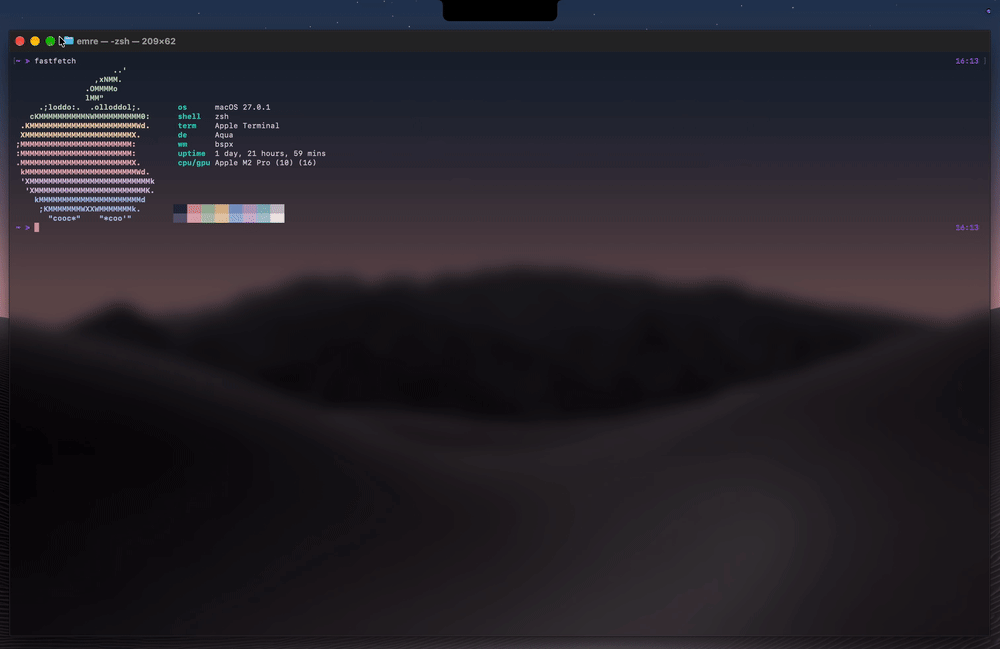</details>

</details>

## Requirements

- macOS
- [Rust](https://rustup.rs)

## Installation

**1. Build it** into `~/bin`:

```sh
git clone https://github.com/emreekici3/bspx.git
cd bspx
cargo install --path . --root ~
```

**2. Add `~/bin` to your `PATH`.** Use `~/.zshenv` rather than `~/.zshrc`, so background tools can find `bspx` too:

```sh
echo 'export PATH="$HOME/bin:$PATH"' >> ~/.zshenv
source ~/.zshenv
```

**3. Install and start the service.** It runs in the background and starts automatically when you log in:

```sh
bspx install
bspx start
```

**4. Grant Accessibility permission.** macOS asks on the first start. Enable `bspx` under *System Settings → Privacy & Security → Accessibility*. bspx starts within a few seconds of the permission being granted; if it does not, run `bspx restart`.

### Updating

```sh
cd bspx
git pull
cargo install --path . --root ~
bspx restart
```

If windows stop moving after an update, macOS has dropped the permission for the new binary: remove `bspx` from the Accessibility list, add `~/bin/bspx` again, and run `bspx restart`.

## Commands

| Command | What it does |
|---|---|
| `bspx focus <dir>` | Focus the neighbouring window |
| `bspx swap <dir>` | Swap with the neighbouring window |
| `bspx warp <dir>` | Move into the neighbouring window's place: it splits as for a new window, and the window keeps the side it came from |
| `bspx resize <dir> [amount]` | Move the window's border |
| `bspx rotate` | Rotate the layout 90° |
| `bspx flip` | Swap the two halves of a split |
| `bspx toggle-split` | Switch a split between side by side and stacked |
| `bspx balance [area]` | Undo every resize, as the windows were when they opened; `area` gives every window the same area instead |
| `bspx zoom [fullscreen\|parent]` | Grow the focused window over the others to the full screen (default) or its split's area; run again to put it back |
| `bspx float` | Float or tile the focused window |
| `bspx raise-floating` | Bring floating windows to the front |
| `bspx grid <rows:cols:x:y:w:h>` | Float the focused window and put it at a grid cell, e.g. `6:6:1:1:4:4` centres it at two thirds of the screen |
| `bspx query` | List windows with their app names |
| `bspx config <key> [value]` | Show or change a setting |
| `bspx rule float\|tile "<app>"` | Never tile an app's windows, or tile them again; `"/regex/"` matches app names by pattern |
| `bspx rule space <space> "<app>"` | Send an app's new windows to a Space |
| `bspx rule grid <rows:cols:x:y:w:h> "<app>"` | Open an app's new windows floating at a grid cell, e.g. `4:4:3:0:1:1` is the top-right quarter of the top-right quarter |
| `bspx label [<n> <name>]` | Name Space `n`; alone, list the Spaces |
| `bspx bind ['<hotkey>']` | Add a keyboard shortcut; alone, list them |
| `bspx space <space>` | Switch to a Space |
| `bspx layout <space> bsp\|float` | Tile a Space, or leave its windows where you put them |
| `bspx send <space>` | Move the focused window to a Space |
| `bspx reload` | Reload the config |
| `bspx install` | Install the login service |
| `bspx start` / `stop` / `restart` | Control the service |
| `bspx uninstall` | Remove the service |
| `bspx run` | Run in the terminal instead of as a service |

`<dir>` is `left`, `down`, `up`, `right` (or `h`, `j`, `k`, `l`).

## Keyboard shortcuts

Bind them in `bspxrc`, one `bspx bind` per shortcut: modifiers, `-`, the key, `:` and the command.

```sh
bspx bind 'alt - h : bspx focus left'
bspx bind 'alt - j : bspx focus down'
bspx bind 'alt - k : bspx focus up'
bspx bind 'alt - l : bspx focus right'

bspx bind 'shift + alt - h : bspx swap left'
bspx bind 'shift + alt - j : bspx swap down'
bspx bind 'shift + alt - k : bspx swap up'
bspx bind 'shift + alt - l : bspx swap right'

bspx bind 'meh - h : bspx warp left'
bspx bind 'meh - j : bspx warp down'
bspx bind 'meh - k : bspx warp up'
bspx bind 'meh - l : bspx warp right'

bspx bind 'ctrl + alt - h : bspx resize left'
bspx bind 'ctrl + alt - j : bspx resize down'
bspx bind 'ctrl + alt - k : bspx resize up'
bspx bind 'ctrl + alt - l : bspx resize right'

bspx bind 'alt - r : bspx rotate'
bspx bind 'alt - e : bspx toggle-split'
bspx bind 'alt - 0 : bspx balance'
bspx bind 'alt - m : bspx zoom'
bspx bind 'shift + alt - m : bspx zoom parent'
bspx bind 'alt - t : bspx float'
bspx bind 'alt - f : bspx raise-floating'

bspx bind 'alt - g : bspx grid 6:6:1:1:4:4'
bspx bind 'alt - return : open -na Terminal'
```

Modifiers are `alt`, `shift`, `cmd`, `ctrl` and `fn`, or one side only with `lalt`, `ralt`, `lshift` and so on; `hyper` is `cmd + alt + shift + ctrl` and `meh` is `alt + shift + ctrl`. The key is a character (whatever key types it on your keyboard layout), a named key (`return`, `tab`, `space`, `escape`, `backspace`, `delete`, `home`, `end`, `pageup`, `pagedown`, `left`, `right`, `up`, `down`, `f1` to `f20`) or a key code such as `0x32`. Put `->` before the `:` to let the key press reach the app too.

A command that is just `bspx ...` runs inside bspx, without starting a process; anything else runs in your `$SHELL`. `bspx bind` alone lists the shortcuts.

## Mouse

- Drag a window by its title bar onto another to swap them.
- Drag the edge of a tiled window to move the split border.
- Hold `alt` and drag anywhere on a window to move it; drop it on another window to swap them.
- Hold `alt` and right-drag to resize a window from its nearest corner; the windows next to it follow.

To split a window instead of swapping with it, pick a second key:

```sh
bspx config mouse_insert_modifier cmd
```

Hold it along with `alt` and drop a window near an edge of another: that window is split in two and the dropped one takes the half on that side (the highlight shows which).

While `alt` is held, clicks do not reach apps. If an app needs `alt`-clicks, pick another key with `mouse_modifier`.

Focus follows mouse and mouse follows focus are off by default:

```sh
bspx config focus_follows_mouse on   # focus the window under the pointer
bspx config mouse_follows_focus on   # move the pointer to windows focused with bspx focus / swap
```

With focus follows mouse, the focused window is also raised: macOS cannot focus a window without raising it unless SIP is disabled. So that floating windows are not buried, a tiled window that would cover one is left alone until you click it. Focus also stays put while Spotlight, a launcher or a menu is open, so they do not close under the pointer.

## Spaces

Name your Spaces (numbered from 1, as in Mission Control) and send apps to them, in `bspxrc`:

```sh
bspx label 1 general
bspx label 2 web
bspx label 3 coding
bspx rule space web "Safari"
```

New Safari windows then go to Space 2. Windows that were already open stay where they are. `bspx space web` switches to Space 2, and `bspx send web` (or `bspx send 2`) moves the focused window there, e.g. with these shortcuts:

```sh
bspx bind 'alt - 1 : bspx space 1'
bspx bind 'alt - 2 : bspx space 2'
bspx bind 'alt - 3 : bspx space 3'
bspx bind 'shift + alt - 1 : bspx send 1'
bspx bind 'shift + alt - 2 : bspx send 2'
bspx bind 'shift + alt - 3 : bspx send 3'
```

`bspx layout coding float` stops tiling Space 3: its windows stay where you put them, and `alt`-drags still move and resize them. `bspx layout coding bsp` tiles it again.

These use the macOS *Switch to Desktop N* shortcuts, so turn them on first: *System Settings → Keyboard → Keyboard Shortcuts → Mission Control*. With SIP enabled, recent macOS only lets a window change Spaces the way a person does it, so bspx holds the window by its title bar and switches Spaces: you go along with it.

## Configuration

The config is a shell script at `~/.config/bspx/bspxrc`, run on startup:

```sh
#!/bin/sh
bspx config gap 8
bspx config padding 8 8 8 8
bspx config animation 0.25
bspx config animation_easing ease_in_out
bspx rule float "System Settings"
```

Start from the example config:

```sh
mkdir -p ~/.config/bspx
curl -L https://raw.githubusercontent.com/emreekici3/bspx/master/examples/bspxrc -o ~/.config/bspx/bspxrc
bspx reload
```

| Setting | Description | Default |
|---|---|---|
| `gap` | Space between windows | `8` |
| `padding` | Space around the edges | `8 8 8 8` |
| `animation` | Animation duration in seconds, `0` to disable | `0.42` |
| `animation_easing` | `ease_in_out` or `ease_out` | `ease_out` |
| `split_ratio` | Share the old window keeps when split | `0.5` |
| `resize_step` | Step for `bspx resize` | `0.05` |
| `drag_swap` | Swap windows by drag and drop, `on` / `off` | `on` |
| `drag_color` | Drop highlight colour, `RRGGBB` or `RRGGBBAA` | `5e9eff40` |
| `mouse_modifier` | Key to hold for mouse moves and resizes: `alt`, `cmd`, `ctrl`, `shift`, `fn` or `off` | `alt` |
| `mouse_insert_modifier` | Also held while moving a window, dropping it splits the window under it instead of swapping: `alt`, `cmd`, `ctrl`, `shift`, `fn` or `off` | `off` |
| `mouse_action1` | Left-drag with the modifier: `move` or `resize` | `move` |
| `mouse_action2` | Right-drag with the modifier: `move` or `resize` | `resize` |
| `mouse_follows_focus` | Move the pointer to windows focused from the keyboard, `on` / `off` | `off` |
| `focus_follows_mouse` | Focus the window under the pointer, `on` / `off` | `off` |
| `log_level` | `error`, `warn`, `info` or `debug`; try `debug` when something misbehaves | `info` |

`bspx rule float "<app>"` keeps an app's windows out of the layout. In rules, use the app name exactly as `bspx query` shows it; on a non-English Mac it is the localized name (e.g. `"Sistem Ayarları"`). The built-in float rules use the English names (System Settings, Calculator, Archive Utility), so add your own with the local names.

An app name between slashes is a regular expression, searched for anywhere in the name. It helps with apps whose name changes or is hard to type:

```sh
bspx rule float "/Webex/"          # any app with Webex in its name
bspx rule float "/^Zoom/"          # names starting with Zoom
bspx rule space 3 "/(?i)slack/"    # ignoring case
```

Any other name must match exactly, so names with brackets or dots need no escaping. `bspx query` ends a floating window's line with the rule that floats it, e.g. `rule: /Webex/`; a window without one matched no rule.

Floating windows cannot be kept above tiled ones without disabling SIP, so bspx does not try; `bspx raise-floating` brings them all back to the front when you need them.

## License

MIT. See `LICENSE.txt`.
