<h1 align="center">cranberry</h1>

<p align="center">
  An animated BSP tiling window manager for macOS, written in Rust.<br>
  Every Space and display keeps its own layout. SIP stays on.
</p>

<p align="center">
  <a href="#install">Install</a> ·
  <a href="#commands">Commands</a> ·
  <a href="#shortcuts">Shortcuts</a> ·
  <a href="#mouse">Mouse</a> ·
  <a href="#spaces-and-displays">Spaces and displays</a> ·
  <a href="#configuration">Configuration</a> ·
  <a href="#demo">Demo</a>
</p>

## Install

You need [Rust](https://rustup.rs). Build cranberry into `~/bin` and start it:

```sh
git clone https://github.com/emreekici3/cranberry.git
cd cranberry
cargo install --path . --root ~

echo 'export PATH="$HOME/bin:$PATH"' >> ~/.zshenv
source ~/.zshenv

mkdir -p ~/.config/cranberry
cp examples/cberryrc ~/.config/cranberry/cberryrc

cberry install
cberry start
```

macOS asks for permission on the first start: enable `cberry` under *System Settings → Privacy & Security → Accessibility*. If cranberry does not start within a few seconds, run `cberry restart`.

To update:

```sh
git pull
cargo install --path . --root ~
cberry restart
```

If windows stop moving after an update, macOS has dropped the permission: remove `cberry` from the Accessibility list, add `~/bin/cberry` again and run `cberry restart`.

## Commands

`<dir>` is `left`, `down`, `up`, `right` (or `h`, `j`, `k`, `l`).

### Windows

| Command | What it does |
|---|---|
| `cberry focus <dir>` | Focus the neighbouring window |
| `cberry swap <dir>` | Swap with the neighbouring window |
| `cberry warp <dir>` | Move into the neighbouring window's place, splitting it |
| `cberry resize <dir> [amount]` | Move a border of the window, tiled or floating |
| `cberry zoom [fullscreen\|parent]` | Grow the window over the others, or put it back |

### Layout

| Command | What it does |
|---|---|
| `cberry rotate` | Rotate the layout 90° |
| `cberry flip` | Swap the two halves of a split |
| `cberry toggle-split` | Switch a split between side by side and stacked |
| `cberry balance [area]` | Undo every resize; `area` gives every window the same area |

### Floating

| Command | What it does |
|---|---|
| `cberry float` | Float or tile the focused window |
| `cberry raise-floating` | Bring floating windows to the front |
| `cberry grid <rows:cols:x:y:w:h>` | Float the window at a grid cell; `6:6:1:1:4:4` centres it |

### Spaces & displays

| Command | What it does |
|---|---|
| `cberry space <space>` | Switch to a Space |
| `cberry send <space>` | Move the focused window to a Space |
| `cberry send-display <next\|prev\|n>` | Move the focused window to another display |
| `cberry label [<n> <name>]` | Name Space `n`; alone, list the Spaces |
| `cberry layout <space> bsp\|float` | Tile a Space, or leave its windows where you put them |

### Rules

| Command | What it does |
|---|---|
| `cberry rule float\|tile "<app>"` | Never tile an app's windows, or tile them again |
| `cberry rule space <space> "<app>"` | Send an app's new windows to a Space |
| `cberry rule grid <rows:cols:x:y:w:h> "<app>"` | Open an app's new windows floating at a grid cell |

### Service

| Command | What it does |
|---|---|
| `cberry install` / `uninstall` | Add or remove the login service |
| `cberry start` / `stop` / `restart` | Control the service |
| `cberry run` | Run in the terminal instead of as a service |
| `cberry reload` | Reload the config |
| `cberry config <key> [value]` | Show or change a setting |
| `cberry bind ['<hotkey>']` | Add a keyboard shortcut; alone, list them |
| `cberry query` | List windows with their app names |

## Shortcuts

Add one `cberry bind` per shortcut to `cberryrc`. [`examples/cberryrc`](examples/cberryrc) has a full set.

```sh
cberry bind 'alt - h : cberry focus left'
cberry bind 'shift + alt - h : cberry swap left'
cberry bind 'meh - h : cberry warp left'
cberry bind 'ctrl + alt - h : cberry resize left'
cberry bind 'alt - t : cberry float'
cberry bind 'alt - return : open -na Terminal'
```

- **Modifiers:** `alt`, `shift`, `cmd`, `ctrl`, `fn`, or one side with `lalt`, `ralt`, `lshift` and so on. `hyper` is `cmd + alt + shift + ctrl`, `meh` is `alt + shift + ctrl`.
- **Keys:** a character, a named key (`return`, `tab`, `space`, `escape`, `backspace`, `delete`, `home`, `end`, `pageup`, `pagedown`, the arrows, `f1` to `f20`) or a key code such as `0x32`.
- **Pass through:** put `->` before the `:` to let the key press reach the app too.

A command that is just `cberry ...` runs inside cranberry without starting a process. Anything else runs in your `$SHELL`.

## Mouse

| Action | What it does |
|---|---|
| Drag a title bar onto a window | Swap the two windows |
| Drag the edge of a tiled window | Move the split border |
| `alt` + drag | Move a window from anywhere on it; drop it on another to swap |
| `alt` + right-drag | Resize from the nearest corner |

To split a window instead of swapping, pick a second key, hold it with `alt` and drop near an edge:

```sh
cberry config mouse_insert_modifier cmd
```

While `alt` is held, clicks do not reach apps. If an app needs `alt`-clicks, choose another key with `mouse_modifier`.

Focus can also follow the pointer, and the pointer can follow focus:

```sh
cberry config focus_follows_mouse on
cberry config mouse_follows_focus on
```

macOS raises the window it focuses unless SIP is disabled, so a tiled window that would cover a floating one is left alone until you click it. Focus stays put while Spotlight, a launcher or a menu is open.

## Spaces and displays

Name your Spaces and send apps to them:

```sh
cberry label 1 general
cberry label 2 web
cberry label 3 coding
cberry rule space web "Safari"

cberry bind 'alt - 2 : cberry space 2'
cberry bind 'shift + alt - 2 : cberry send 2'
```

Turn on the *Switch to Desktop N* shortcuts first: *System Settings → Keyboard → Keyboard Shortcuts → Mission Control*. With SIP enabled, recent macOS only lets a window change Spaces the way a person does it, so cranberry carries the window by its title bar and you go along with it.

`cberry layout coding float` stops tiling a Space. `cberry layout coding bsp` tiles it again.

Each display has its own layout, and commands act on the display of the focused window. At the edge of a display, `focus`, `swap` and `warp` carry on to the next one. Spaces are numbered from 1 on each display. With *Displays have separate Spaces* off, the displays share one Space and only the main one is tiled.

## Configuration

The config is a shell script at `~/.config/cranberry/cberryrc`, run on startup:

```sh
#!/bin/sh
cberry config gap 8
cberry config padding 8 8 8 8
cberry config animation 0.25
cberry rule float "System Settings"
```

| Setting | Description | Default |
|---|---|---|
| `gap` | Space between windows | `8` |
| `padding` | Space around the edges | `8 8 8 8` |
| `animation` | Animation duration in seconds, `0` to disable | `0.42` |
| `split_ratio` | Share the old window keeps when split | `0.5` |
| `resize_step` | Step for `cberry resize` | `0.05` |
| `drag_swap` | Swap windows by drag and drop, `on` / `off` | `on` |
| `drag_color` | Drop highlight colour, `RRGGBB` or `RRGGBBAA` | `5e9eff40` |
| `mouse_modifier` | Key for mouse moves and resizes: `alt`, `cmd`, `ctrl`, `shift`, `fn` or `off` | `alt` |
| `mouse_insert_modifier` | Second key that splits on drop, same values | `off` |
| `mouse_action1` | Left-drag with the modifier: `move` or `resize` | `move` |
| `mouse_action2` | Right-drag with the modifier: `move` or `resize` | `resize` |
| `mouse_follows_focus` | Move the pointer to windows focused from the keyboard, `on` / `off` | `off` |
| `focus_follows_mouse` | Focus the window under the pointer, `on` / `off` | `off` |
| `log_level` | `error`, `warn`, `info` or `debug` | `info` |

### App names in rules

Use the name exactly as `cberry query` shows it. On a non-English Mac that is the localized name, such as `"Sistem Ayarları"`; the built-in float rules use the English names. A name between slashes is a regular expression:

```sh
cberry rule float "/Webex/"          # any app with Webex in its name
cberry rule float "/^Zoom/"          # names starting with Zoom
cberry rule space 3 "/(?i)slack/"    # ignoring case
```

Floating windows cannot stay above tiled ones without disabling SIP. `cberry raise-floating` brings them back to the front.

## Demo

<details><summary>Focus — <code>cberry focus</code></summary><br>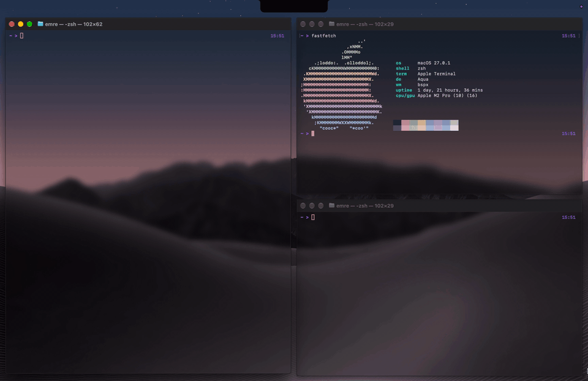</details>
<details><summary>Swap — <code>cberry swap</code></summary><br>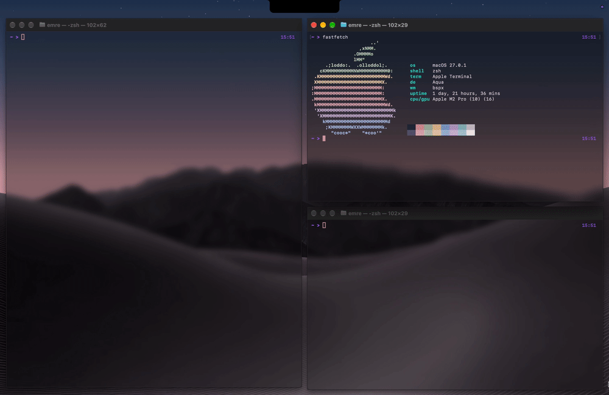</details>
<details><summary>Warp — <code>cberry warp</code></summary><br>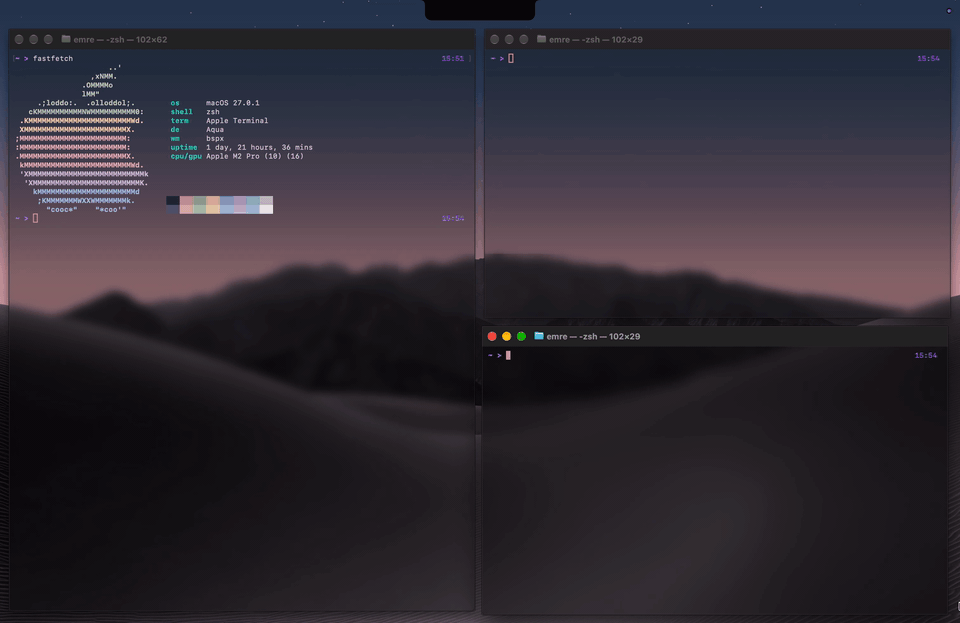</details>
<details><summary>Resize — <code>cberry resize</code></summary><br>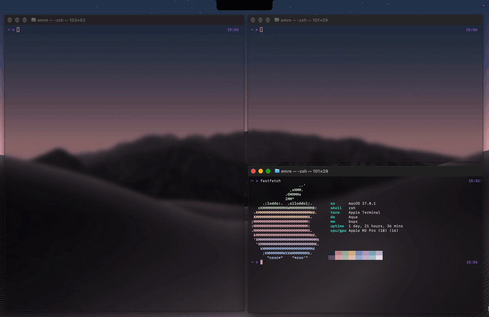</details>
<details><summary>Rotate — <code>cberry rotate</code></summary><br>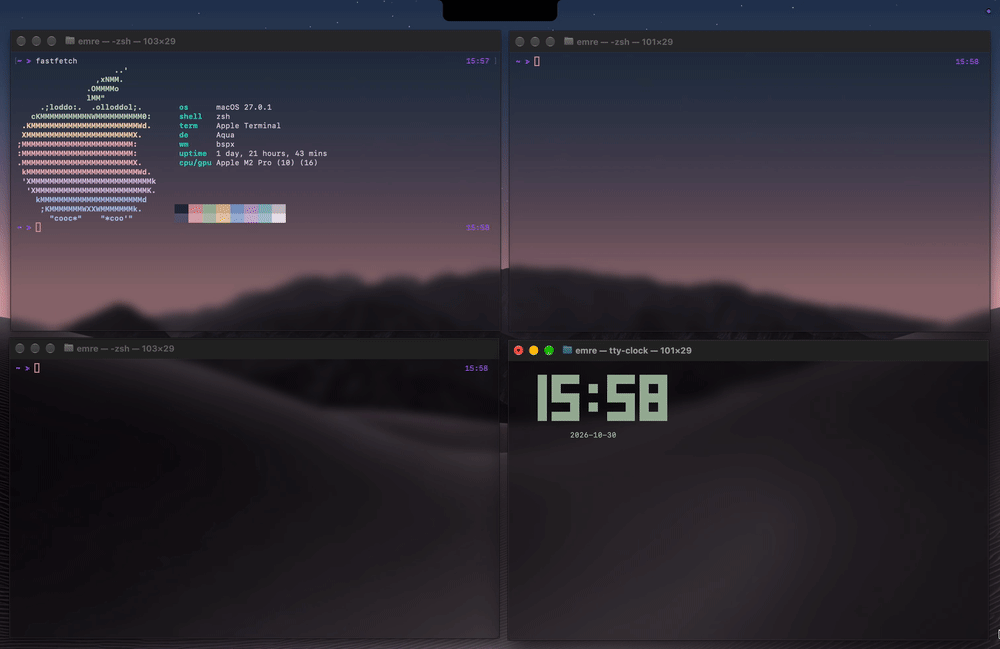</details>
<details><summary>Toggle split — <code>cberry toggle-split</code></summary><br>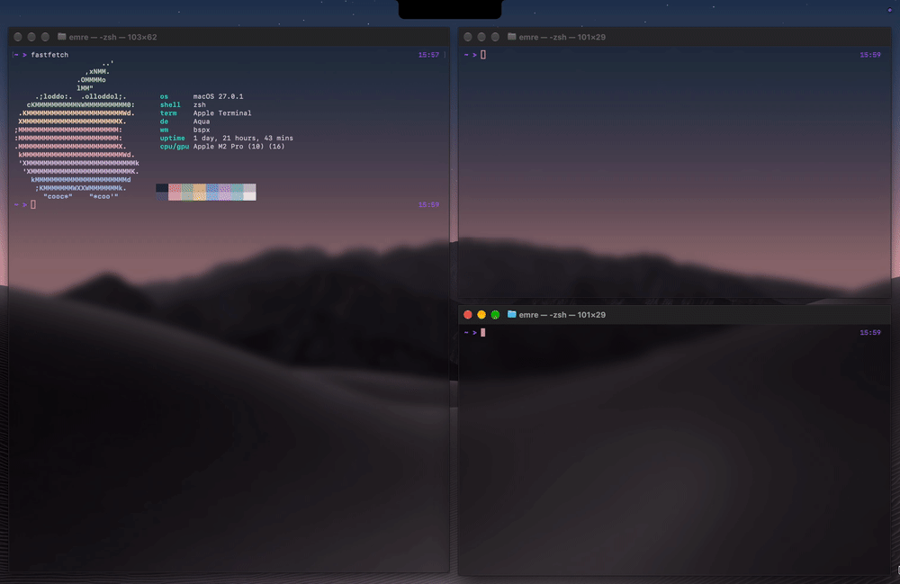</details>
<details><summary>Balance — <code>cberry balance</code></summary><br></details>
<details><summary>Zoom — <code>cberry zoom</code></summary><br>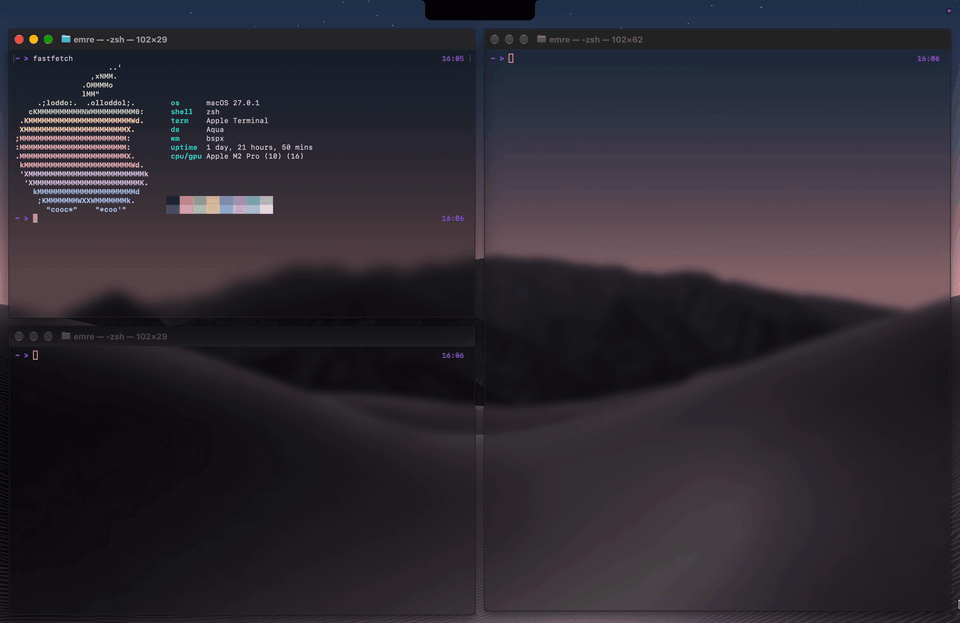</details>
<details><summary>Zoom parent — <code>cberry zoom parent</code></summary><br>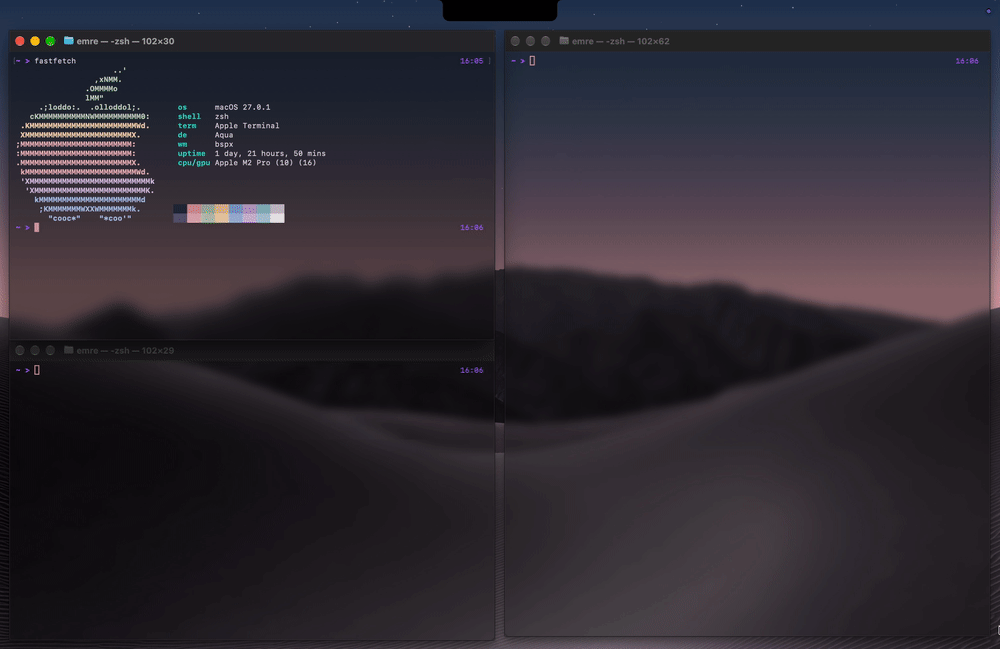</details>
<details><summary>Float — <code>cberry float</code></summary><br>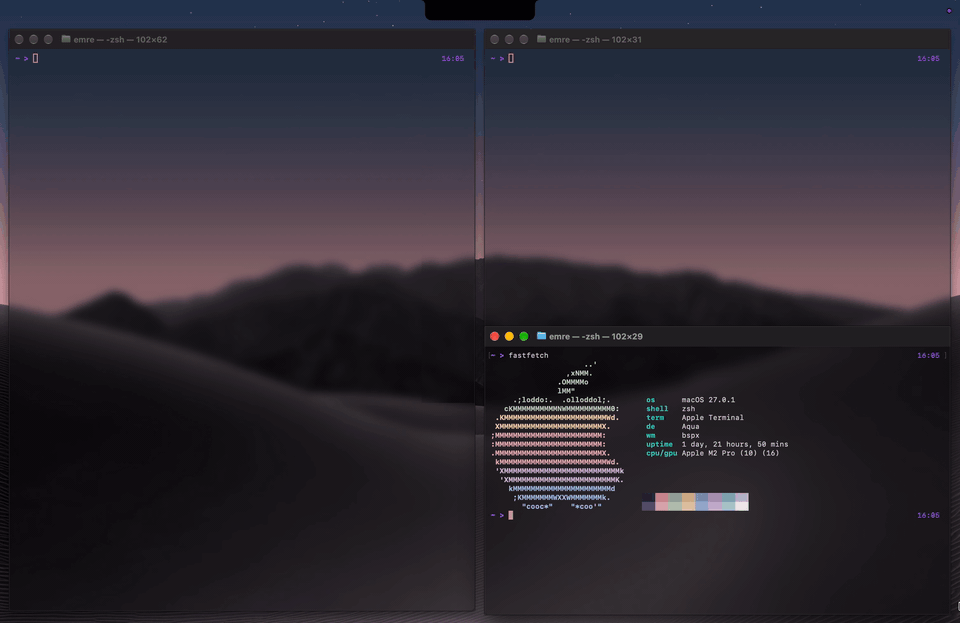</details>
<details><summary>Swap with the mouse</summary><br>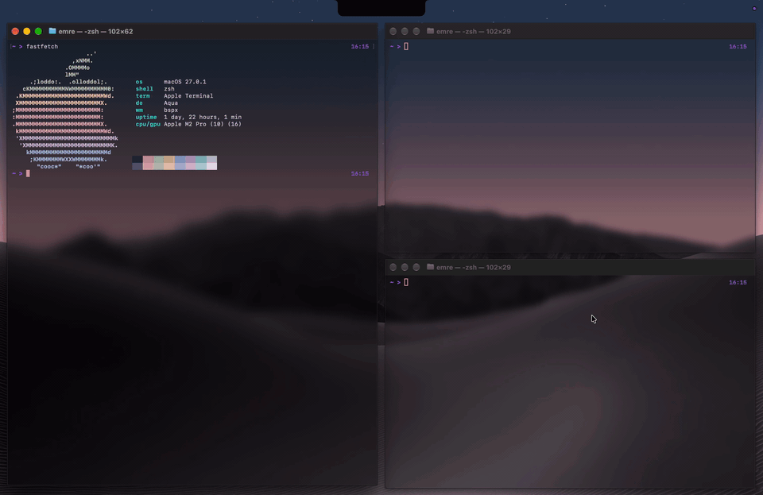</details>
<details><summary>Split by dropping</summary><br>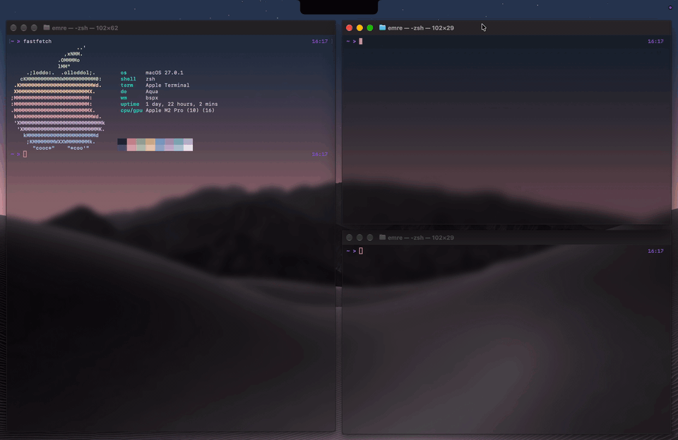</details>
<details><summary>Move with <code>alt</code>-drag</summary><br>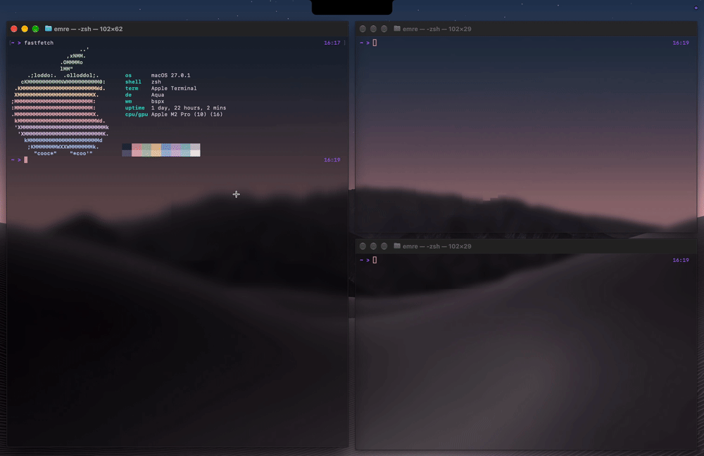alt</code>-drag"></details>
<details><summary>Resize with <code>alt</code>-right-drag</summary><br>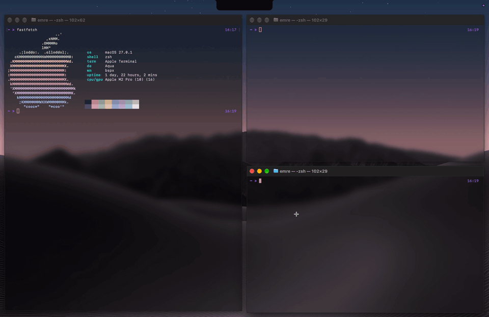alt</code>-right-drag"></details>
<details><summary>Switch Spaces — <code>cberry space</code></summary><br>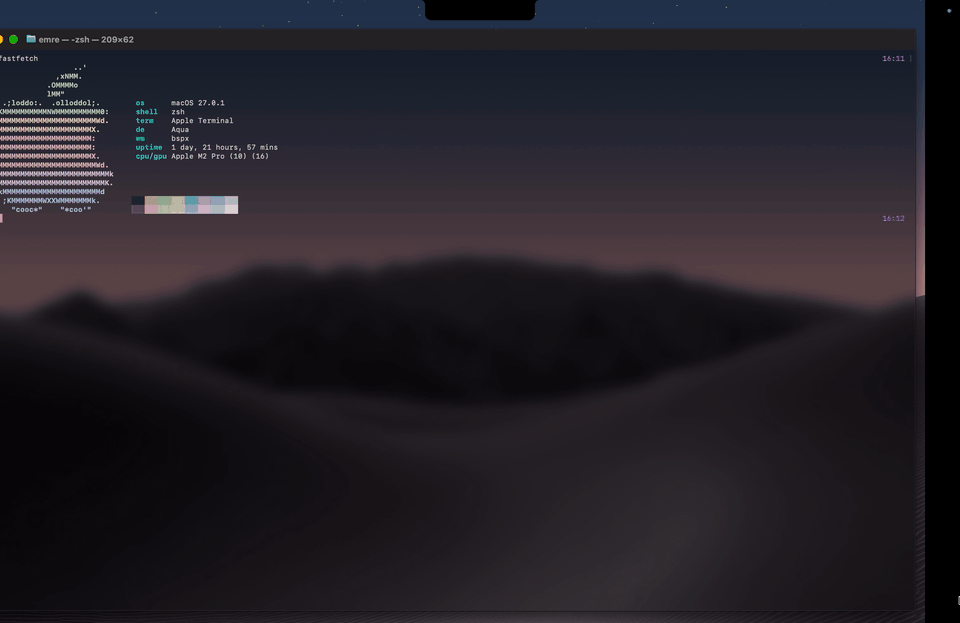</details>
<details><summary>Take a window to a Space — <code>cberry send</code></summary><br>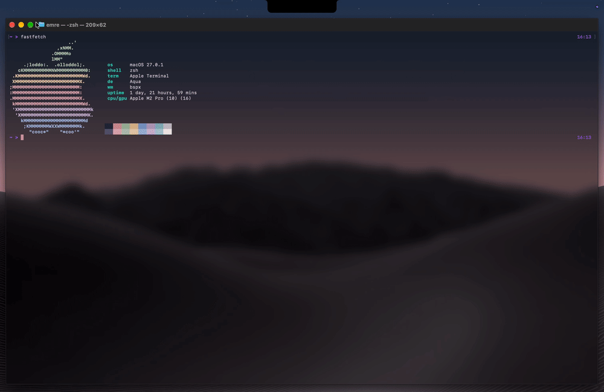</details>

## License

MIT. See [`LICENSE.txt`](LICENSE.txt).
