# Demo

Focus — <code>cberry focus</code>
 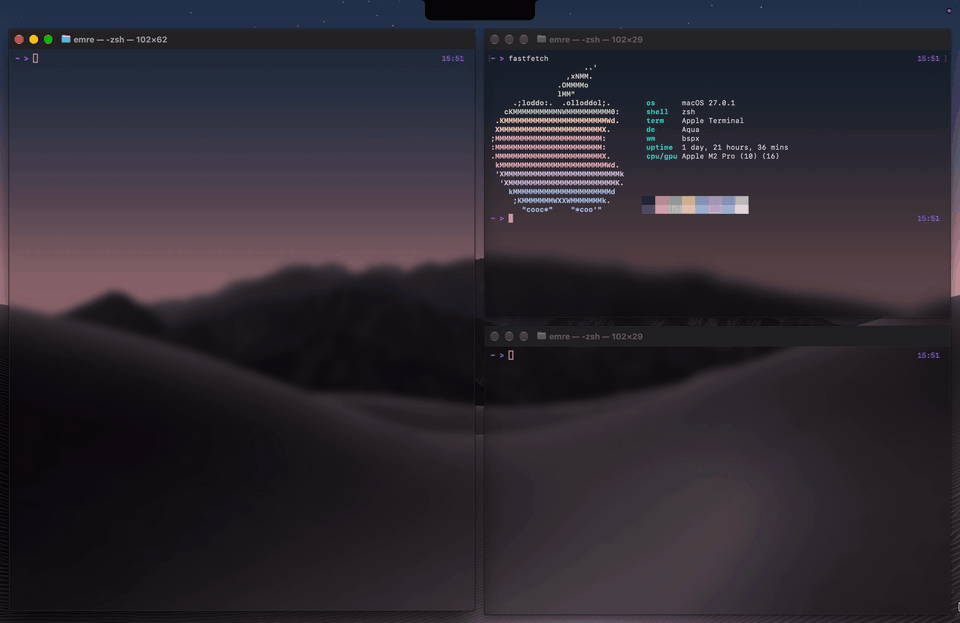

Swap — <code>cberry swap</code>
 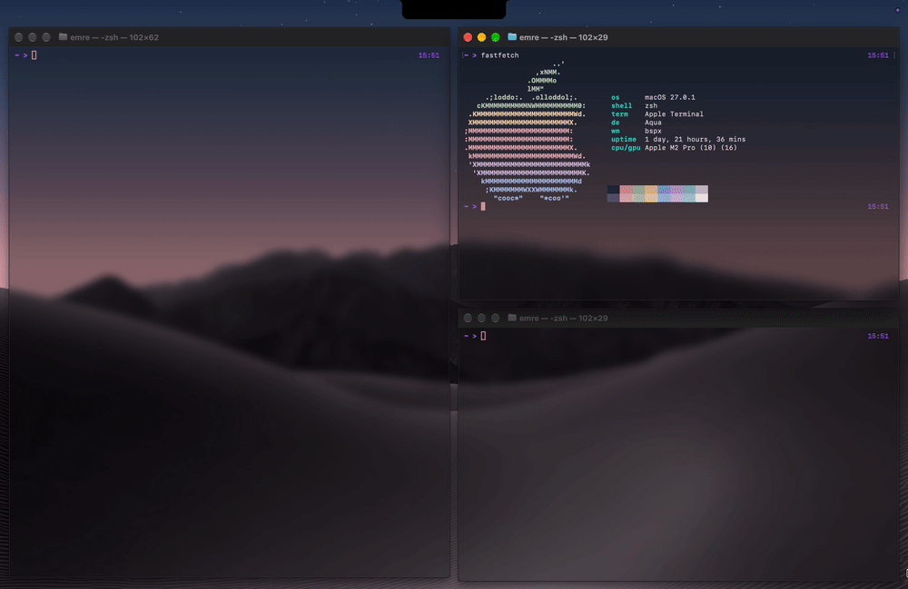

Warp — <code>cberry warp</code>
 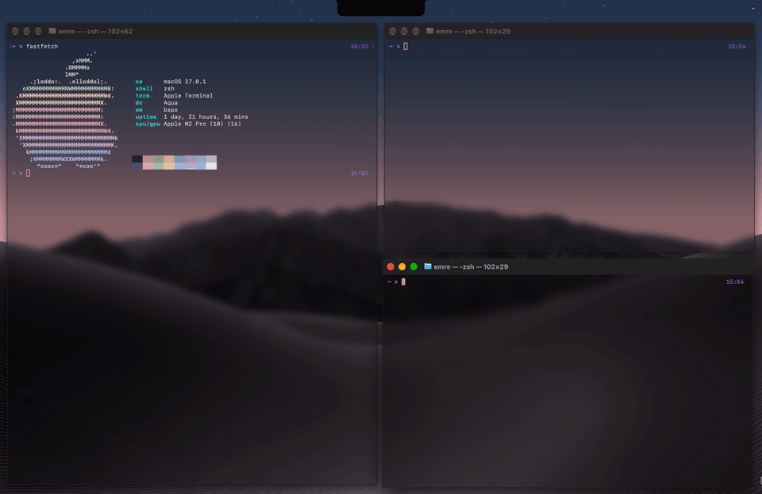

Resize — <code>cberry resize</code>
 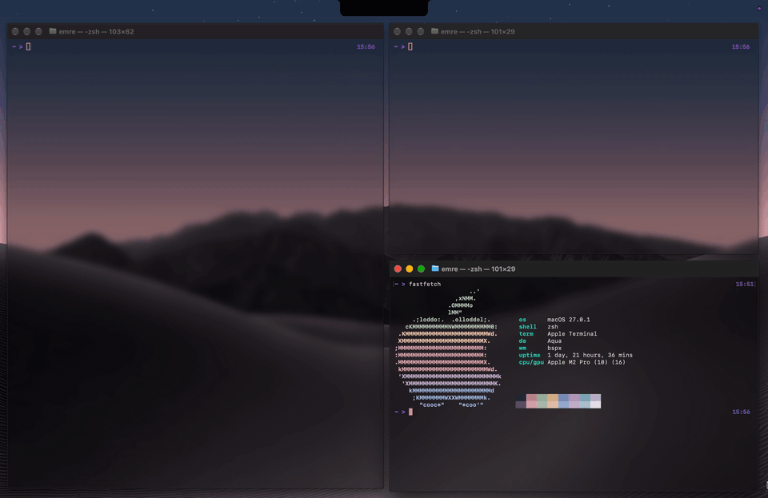

Rotate — <code>cberry rotate</code>
 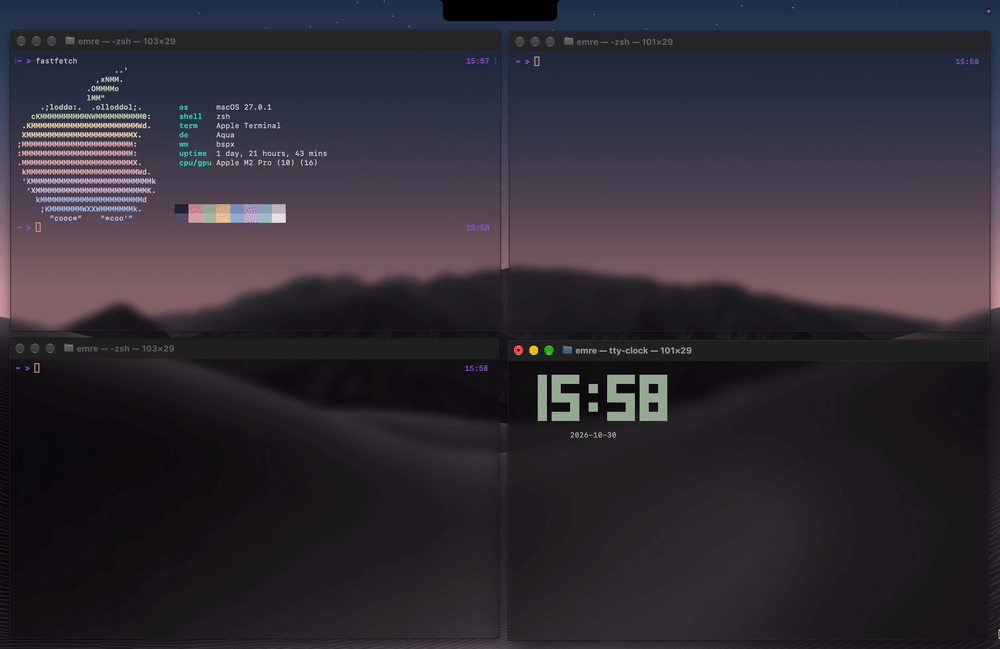

Toggle split — <code>cberry toggle-split</code>
 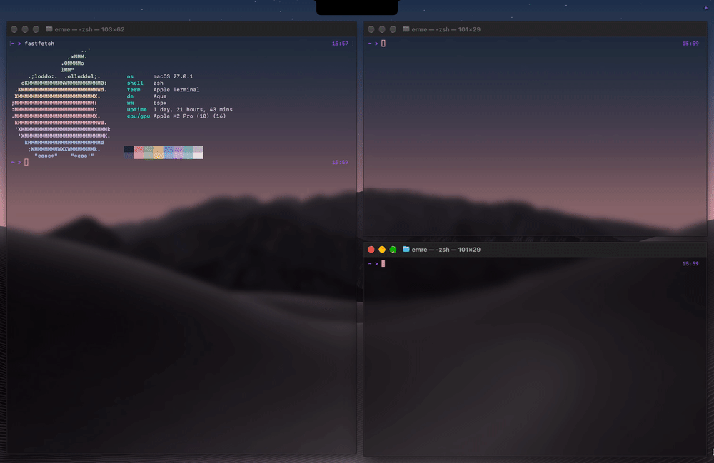

Balance — <code>cberry balance</code>
 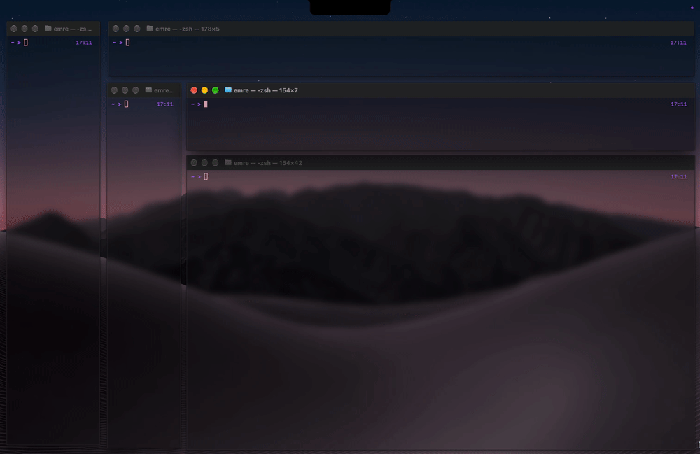

Zoom — <code>cberry zoom</code>
 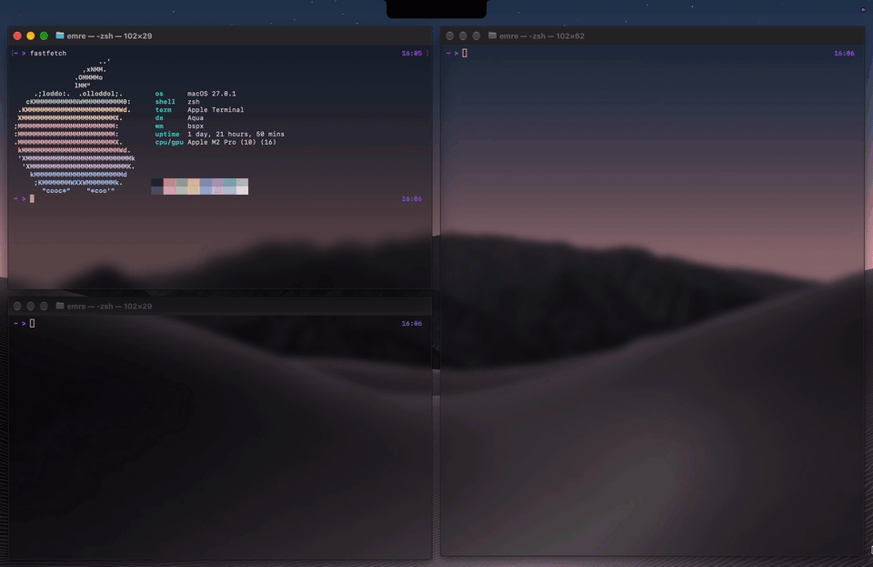

Zoom parent — <code>cberry zoom parent</code>
 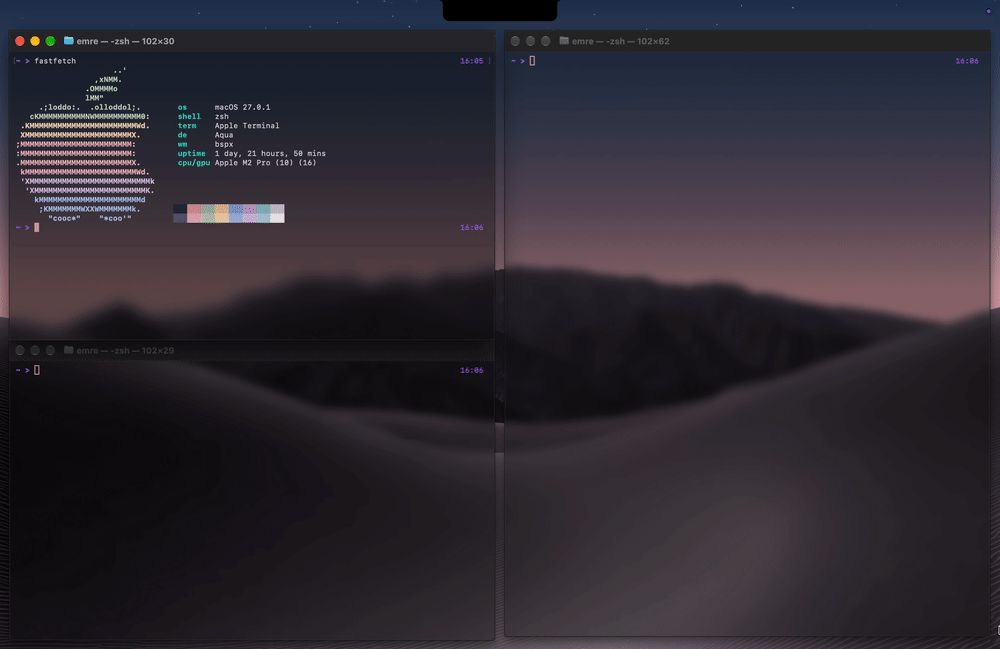

Float — <code>cberry float</code>
 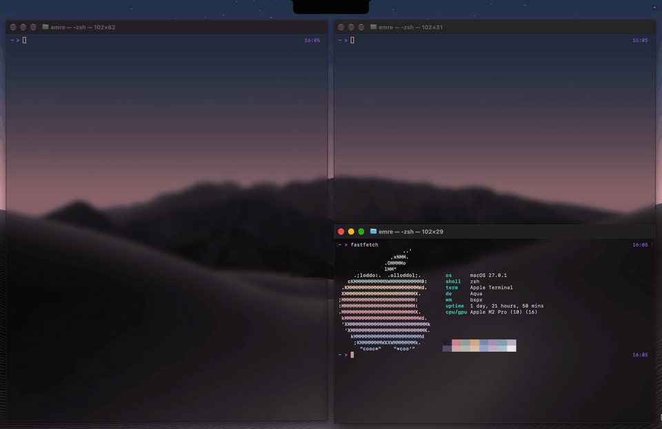

Swap with the mouse
 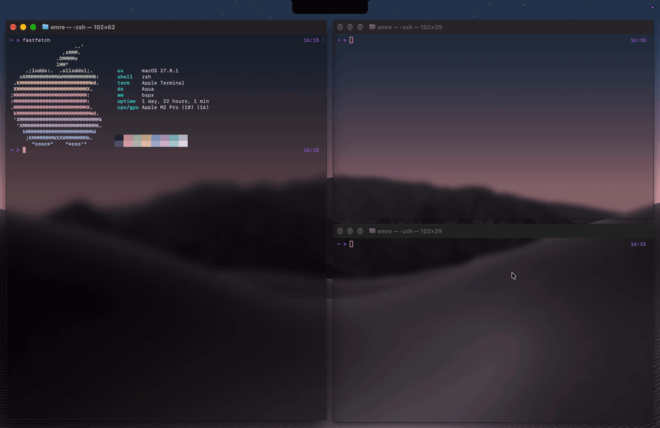

Split by dropping
 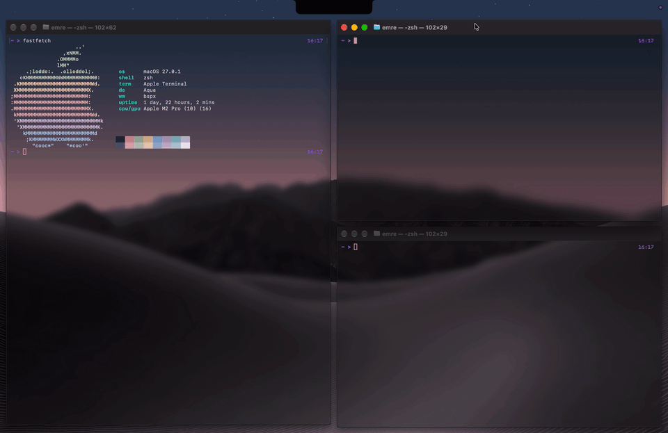

Move with <code>alt</code>-drag
 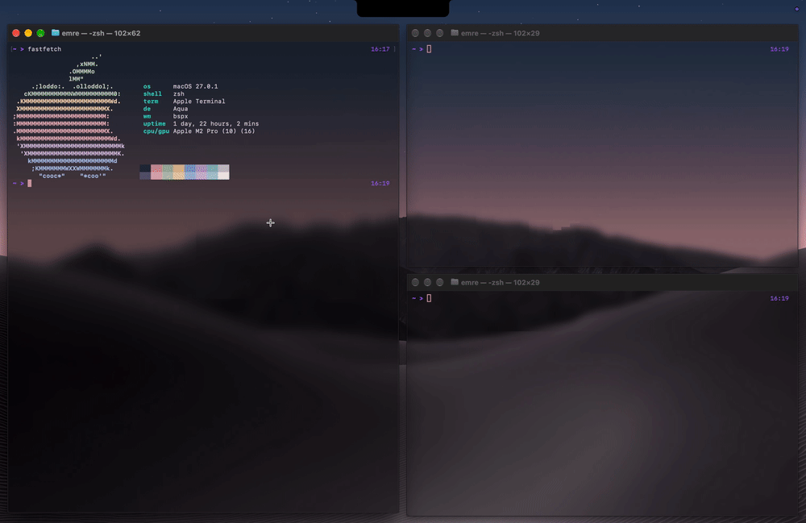alt</code>-drag">

Resize with <code>alt</code>-right-drag
 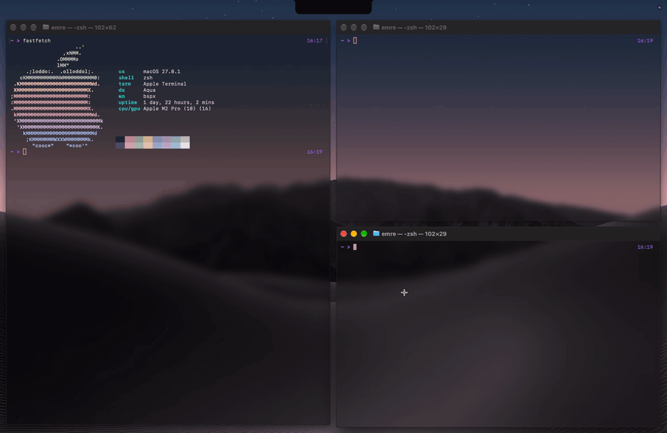alt</code>-right-drag">

Switch Spaces — <code>cberry space</code>
 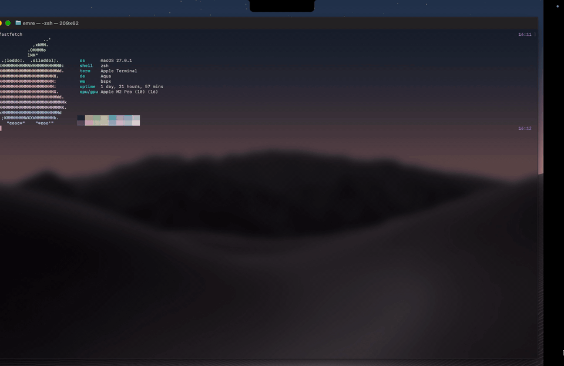

Take a window to a Space — <code>cberry send</code>
 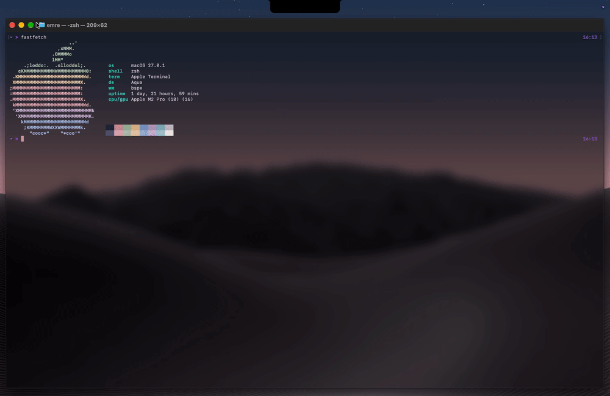

[Back to the README](../README.md)
